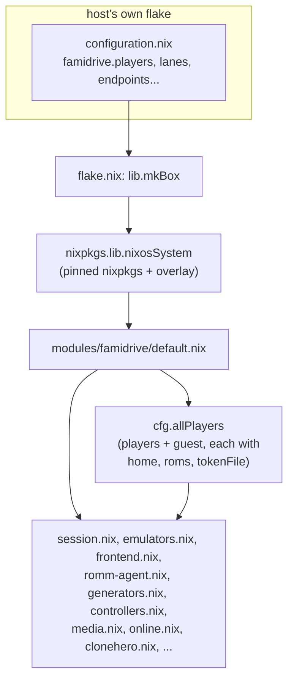

# Architecture

How a FamiDrive box is put together: the flake, the module, the packages,
and how they hand off to each other from boot to a game on the TV. See
[the README's Layout section](../README.md#layout) for the file map this
expands on, and [USAGE.md](USAGE.md) for every option's exact description.

## The flake

[flake.nix](../flake.nix) pins one nixpkgs (`nixos-26.05`) that every box
is built from, so two boxes built from the same FamiDrive revision run
bit-identical emulators — not just the same version, the same build. That
matters for netplay (RetroArch, Dolphin, Eden): lockstep and lobby
matching both assume identical binaries. A second input,
`nixpkgs-unstable`, feeds `overlays.default`, which is where the few
fast-moving emulators (Eden, RPCS3) and the Jellyfin client come from, and
where every `pkgs/*` package in this repo is added to `pkgs`.

`lib.mkBox` is the flake's one public entry point for building a box:
given a host's own module (its hardware config, its `famidrive.*`
settings), it calls `nixpkgs.lib.nixosSystem` with this flake's pinned
`nixpkgs` and `nixosModules.default` (the `famidrive` module, home-manager
and sops-nix wired in). There are no hosts in this repo — every real box
is a small private flake elsewhere that imports this one and calls
`mkBox` on its own `configuration.nix` (see
[INSTALLATION.md](INSTALLATION.md)).

## The module: one option surface, many imports

[modules/famidrive/default.nix](../modules/famidrive/default.nix) is the
only file a host's module ever reaches into. It declares the
host-facing options (`players`, `primaryPlayer`, `guest.enable`, `lanes`,
`romm.*`, `dataDir`, `localRoms`) and imports every other file under
`modules/famidrive/` as a submodule — those files add their own options
under the same `famidrive.*` namespace (`famidrive.media.kodi`,
`famidrive.cloneHero`, `famidrive.gpu`, ...) but a host never imports them
directly.

The central piece of plumbing is `cfg.allPlayers`: `default.nix` turns
each entry in `famidrive.players` into a full player record (Linux
account, RomM owner, home directory, ROM folder, RomM token file) and
adds the guest (no RomM account, saves stay local) when
`famidrive.guest.enable` is on. Every other module reads `cfg.allPlayers`,
never `cfg.players`, when it needs "every real account on this box".



### `famidrive.playerHome`: per-player home-manager config

Several modules (`frontend.nix`, `session.nix`, `settings.nix`,
`clonehero.nix`, `controllers.nix`, ...) need to write into *each
player's* home directory — their ES-DE folder, their Dolphin config,
their Settings menu. Rather than each writing `home-manager.users.<name>`
by hand, they each assign a `famidrive.playerHome` function,
`{ lib, famidrivePlayer, ... }: { ...home-manager config... }`, that
`default.nix` evaluates once per entry in `cfg.allPlayers` and wires into
that player's home-manager configuration (the guest gets home-manager
config too, since they're a real Linux account for the session, just with
no RomM token). This is the pattern to follow for anything that's "every
player's own copy of X": write a `playerHome` function, not a loop over
`cfg.allPlayers` with `home-manager.users.${p.user}` by hand.

### Config ownership: who writes what

[modules/famidrive/lib/seed.nix](../modules/famidrive/lib/seed.nix) is
the other piece of shared plumbing, used from `playerHome` activation
scripts throughout the module. Nix and the apps on a box both want to
write some of the same config files (ES-DE's `es_settings.xml`, Dolphin's
INIs, RetroArch's `retroarch.cfg`, RPCS3's YAML, Jellyfin MPV Shim's
`conf.json`), and a plain home-manager symlink into the read-only Nix
store breaks any app that rewrites its own config on exit. Three helpers
cover every case this module needs:

- **`seed`**: copy a starting file in only if none exists yet. Used for
  files Nix only wants to give a first value to (gamelist placeholders);
  the app owns it completely afterwards.
- **`lockKeys`**: force a small, named set of keys back to FamiDrive's
  value on every activation (every `nixos-rebuild switch`), leaving
  everything else in the file to the app. Used for the handful of keys
  FamiDrive actually depends on being a certain way (Dolphin's GameCube
  pad mapping, RetroArch's menu combo, quit confirmation dialogs turned
  off).
- **`defaultKeys`**: set keys only where the file has none yet — a
  starting value the player can then change from the TV and keep. Used
  for a new theme's starting options, and ES-DE's starting collections
  and startup system, in `es_settings.xml`.

Files only Nix ever writes (`es_systems.xml`, theme folders) are plain
home-manager symlinks instead; there's no app on the other end to fight
with. Steam's VDF files are a special case with their own tool
(`famidrive-steam-config`, below) because they need structural edits, not
just key/value lines.

## Boot to "Who's playing?" to a game

[modules/famidrive/session.nix](../modules/famidrive/session.nix) is
where greetd, gamescope, ES-DE and every per-session setup step meet. The
shape of a boot, in order:

```mermaid
flowchart TD
    boot["boot: Plymouth splash (boot.nix)"] --> greetd["greetd"]
    greetd -->|"more than one player"| picker["famidrive-picker\n(\"Who's playing?\", its own gamescope)"]
    greetd -->|"one player, no guest"| session
    picker -->|"pick a player"| session["famidrive-session script\n(session.nix, inside gamescope -e)"]
    session --> steamIdle["stop famidrive-steam-background.service\n(if the steam lane is on)"]
    session --> steamCfg["famidrive-steam-config\n(Proton pins, Steam Input, launch options)"]
    session --> steamStart["steam -silent &"]
    session --> romm["romm-agent gamelists / avatar / eden-profile /\nfirmware-install / textures / eden-gamedir"]
    session --> music["mpv: ES-DE/music, shuffled, behind the menu"]
    session --> quit["famidrive-quit &\n(watches every pad for Select+Start)"]
    session --> esde["gamescope-fg --frontend es-de"]
    esde -->|"player picks a game"| launch["famidrive-launch SYSTEM ROM"]
    launch --> savePull["romm-agent save-pull"]
    launch --> game["gamescope-fg CMD\n(the emulator / Steam / Heroic / ...)"]
    game --> savePush["romm-agent save-push"]
    esde -->|"ES-DE Quit, or Select+Start, or a crash"| endSession["famidrive-end-session"]
    endSession --> steamShutdown["steam -shutdown, wait"]
    endSession --> steamBackground["start famidrive-steam-background.service"]
    endSession --> greetd
```

A few things worth calling out:

- **`gamescope -e`** (Steam-integration mode) is what makes window focus
  work at all without Steam acting as the shell. In that mode gamescope
  only shows windows carrying a `STEAM_GAME` app-id, and which one is on
  top is a list on the root window gamescope reads — a job Steam
  normally does. **`gamescope-fg`** ([pkgs/gamescope-fg](../pkgs/gamescope-fg))
  does that job instead: `--frontend` tags ES-DE's window and makes it
  the base layer, a plain `CMD...` tags a game's window and puts it on
  top until `CMD` exits, and `--steam APPID` launches a game through the
  already-running Steam client and waits on it. Nothing is focusable
  without this script, which is why a FamiDrive session never runs
  gamescope without it in front of ES-DE and every launch.
- **Every launch goes through `famidrive-launch`** (built in
  [frontend.nix](../modules/famidrive/frontend.nix) from the
  `famidrive.systems` table). It pulls the game's newest save from RomM
  (consoles only, and only for players with a RomM agent config),
  runs the emulator under `gamescope-fg`, then pushes the save back. A
  system's own `before`/`after` shell (set in `emulators.nix`) runs
  outside the quittable process group, so a RetroAchievements watcher or a
  score push still happens even when the player quits with Select+Start.
- **The idle Steam service.** When the `steam` lane is on, every
  non-guest player gets `linger = true` and a
  `famidrive-steam-background.service` lingering systemd user service
  that runs Steam under Xvfb (`xvfb-run steam -silent`) from boot, so
  Remote Play and remote installs work before anyone is picked on
  "Who's playing?". It's stopped right before a player's own session
  writes Steam's config files and starts its own Steam under gamescope
  (there's never two Steam processes at once), and
  `famidrive-end-session` starts it again once that session ends. See
  [pkgs/famidrive-end-session](../pkgs/famidrive-end-session) and the
  `hasLane "steam"` block in `session.nix`.
- **`famidrive-quit`** ([pkgs/famidrive-quit](../pkgs/famidrive-quit))
  runs for the whole session, watching every gamepad read-only (never
  grabbed, so the game still sees every press) for Select+Start held
  down. `gamescope-fg` records the running game's process group (or, for
  a Steam game, its process tree, or a command to run for something that
  needs a polite close like Big Picture) in `$XDG_RUNTIME_DIR`, and
  `famidrive-quit` is what actually signals it.
- **`famidrive-picker`** ([pkgs/famidrive-picker](../pkgs/famidrive-picker))
  only exists as greetd's greeter on boxes with more than one player (the
  guest counts). It's a separate gamescope session of its own ES-DE-styled
  UI, and picking a player just asks greetd to start the same
  `famidrive-session` script a one-player box autologins straight into.

## Systems, emulators and the library

[modules/famidrive/emulators.nix](../modules/famidrive/emulators.nix)
defines `famidrive.systems`, the single table every console, Steam,
Heroic, Lutris, Minecraft, Clone Hero/YARG, osu!, the Tux games and Settings all
register themselves into — one attrset per ES-DE folder name, with its
full name, extensions, launch command, RomM platform, save layout and
theme. Nothing reads individual option trees for "what systems exist";
everything downstream reads this one table:

- **[frontend.nix](../modules/famidrive/frontend.nix)** renders it into
  `es_systems.xml` and `es_systems_sorting.xml` (symlinked into every
  player's ES-DE folder) and builds `famidrive-launch`, whose big `case`
  statement dispatches on system name to each one's `command`.
- **[romm-agent.nix](../modules/famidrive/romm-agent.nix)** filters it
  down to systems with a `rommPlatform` set and writes that (plus each
  player's own save layout) into JSON configs under
  `/etc/famidrive/romm/` for the agent to read.
- **[generators.nix](../modules/famidrive/generators.nix)** fills in the
  per-player systems (`steam`, `epic` and `desktop` from Heroic,
  `lutris`, `minecraft` via `desktop`) whose entries aren't static — see
  below.

RetroArch-run systems share one RetroArch build (`retroarch.withCores`,
one core per system) and one controller/save setup; everything else
(Dolphin, Eden, Ryujinx, PCSX2, RPCS3, PPSSPP, Cemu, Azahar, Heroic,
Prism, Clone Hero, YARG, Kodi, ...) is its own emulator with its own
command in the table.

### The RomM agent: the box's only link to RomM

[pkgs/romm-agent](../pkgs/romm-agent) (Python, wrapped with `dolphin-tool`,
`7zz` and `rpcs3 --installfw` on its `PATH` for game-ID derivation and
firmware installs) has two roles, run as different Linux users:

1. **Library** (`romm-agent pull` / `firmware`): runs as a dedicated
   `famidrive-library` system account, with the *primary* player's RomM
   token, into `dataDir` — the shared ROMs, box art and firmware every
   player's ES-DE reads but can't write. A systemd timer
   (`romm-library-pull`) repeats this every 30 minutes; `gamelists`,
   `textures` and `eden-gamedir` run once per session instead (session.nix),
   since they need to be fresh before that player's ES-DE starts.
2. **Saves** (`romm-agent save-pull` / `save-push`, called by
   `famidrive-launch` around every game; `reconcile`, on a per-player
   15-minute timer as a backstop for a crash or power cut): runs as that
   player's own Linux account, with their own RomM token, so their saves
   go up as their own RomM device and never cross with another player's.

The guest has no RomM token at all, so every RomM-touching step in
`famidrive-launch` and `session.nix` is skipped for them — their saves
just stay on the box.

### Generators: PC lanes without a scan button

[modules/famidrive/generators.nix](../modules/famidrive/generators.nix)
and [pkgs/famidrive-generators](../pkgs/famidrive-generators) (Python)
exist because Steam, Heroic, Lutris and Prism each keep their own idea of
"installed games" that Nix can't declare — a player installs and
uninstalls through the app itself. A systemd path unit per
player-and-lane watches that lane's install manifest (Steam's
`steamapps/`, Heroic's stores' `installed.json` files, Lutris's
`pga.db`, Prism's
`instances/`) and reruns `famidrive-generate <lane> <source> <out>` on
any change, which rewrites that lane's ES-DE placeholder folder to hold
exactly one placeholder file per installed game — the placeholder's
*content* is the launch ID `famidrive-launch` hands to the real launcher,
its *filename* is what ES-DE shows. A second, chained service per lane
(`famidrive-steam-media-<player>`, `famidrive-heroic-media-<player>`)
fills in that game's real art and details from Steam's CDN/store or
Heroic's own store cache, without holding up the first boot.

## Controllers and input

[modules/famidrive/controllers.nix](../modules/famidrive/controllers.nix)
is config (GameCube ports, Wii Remote slots, face-button layout, pad
mapping) rather than a long-running process — it writes Dolphin's
`GCPadNew.ini`/`WiimoteNew.ini`, RetroArch's remap files and menu-combo
key through `seed.nix`'s `lockKeys`. The packages that actually touch
input at runtime:

- **[pkgs/famidrive-pads](../pkgs/famidrive-pads)**: run by
  `famidrive-launch` just before a GameCube/Wii/Switch game, since
  Dolphin and Eden each bind a controller by its own notion of identity
  (SDL name for Dolphin, GUID + raw button numbers for Eden) that a
  binding made for one pad won't satisfy for another.
- **[pkgs/famidrive-bluetooth](../pkgs/famidrive-bluetooth)**: pairing
  from the couch (`famidrive-bluetooth pair`/`forget`), driven from
  Controllers-system entries that `settings.nix` writes.
- **[pkgs/famidrive-padmouse](../pkgs/famidrive-padmouse)**: a virtual
  mouse+keyboard over every connected pad, run by `gamescope-fg` while
  Steam waits on a mouse-only client prompt (EULA, cloud-save conflict)
  that has no controller navigation.
- **[pkgs/famidrive-quit](../pkgs/famidrive-quit)**: the Select+Start
  quit combo, described above.
- **[pkgs/famidrive-network](../pkgs/famidrive-network)** and
  **[pkgs/famidrive-hardware](../pkgs/famidrive-hardware)** aren't
  controller packages, but follow the same "no screens of its own, just
  ES-DE Settings entries and toasts" pattern as `famidrive-bluetooth`:
  Wi-Fi/Ethernet join-and-forget, and the GPU-driver-vs-hardware check
  behind `famidrive.gpu`.

## Overlays: toasts and the performance overlay

[modules/famidrive/overlays.nix](../modules/famidrive/overlays.nix) is
the one place that decides where two kinds of on-screen-over-everything
UI are drawn, box-wide, with each player able to move theirs:

- **[pkgs/famidrive-toast](../pkgs/famidrive-toast)** runs a daemon once
  per player session, before ES-DE, drawing into a transparent window on
  gamescope's Steam overlay layer (`STEAM_OVERLAY`), which composites
  over the menu, a game or Kodi without taking focus. Anything in the
  session — `romm-agent`, `famidrive-generators`, Heroic's own desktop
  notifications, RetroAchievements unlocks via `famidrive-cheevos` — sends
  a toast by running `famidrive-toast` once, which hands it to the daemon
  over a Unix socket and returns immediately; without a daemon running
  (an SSH session) it just prints to stderr and exits 0, since a toast is
  never worth failing the caller over.
- **MangoHud**, gamescope's own external overlay (`--mangoapp`), is the
  *other* thing on that compositing path — the two share the slot, which
  is why the toast daemon deliberately uses the Steam overlay layer
  instead and not the external one.

## Feature modules that plug into the same seams

Most of the remaining `modules/famidrive/*.nix` files are a pattern
already covered above, applied to one feature: a `famidrive.<feature>`
option tree, a `playerHome` (or plain `systemd.services`) block, and
often a small Python tool in `pkgs/` that does the actual file
surgery as that player at session start or home-manager activation.

| Module | Package | What it owns |
|---|---|---|
| [clonehero.nix](../modules/famidrive/clonehero.nix) | [famidrive-clonehero](../pkgs/famidrive-clonehero) | The box's shared Chorus-Encore song library (downloaded to `dataDir`, not the Nix store); per-player profiles, scores and bindings; sync with a hand-added RomM entry |
| [yarg.nix](../modules/famidrive/yarg.nix) | — | Plays the same shared Clone Hero song library; its own scores/profiles sync under its own RomM entry |
| [minecraft.nix](../modules/famidrive/minecraft.nix) | [famidrive-prism](../pkgs/famidrive-prism) | Declares Prism Launcher instances (MC/Fabric version, mods, servers); Prism still owns worlds and anything added by hand |
| [thunderstore.nix](../modules/famidrive/thunderstore.nix) | [famidrive-thunderstore](../pkgs/famidrive-thunderstore) | Per-player BepInEx mod packs (Thunderstore ids) unpacked into that player's Steam game folder, with that player's launch options set to load BepInEx |
| [nexusmods.nix](../modules/famidrive/nexusmods.nix) | [famidrive-nexusmods](../pkgs/famidrive-nexusmods) | Per-player Nexus Mods collections, downloaded with their own API key and installed/removed as the spec changes |
| [ryujinx.nix](../modules/famidrive/ryujinx.nix) | [famidrive-ryujinx](../pkgs/famidrive-ryujinx) | Switch games that need Ryujinx instead of Eden (Skyline-plugin games); bridges the save through Eden's folder each launch so RomM only ever syncs one copy |
| [retroachievements.nix](../modules/famidrive/retroachievements.nix) | [famidrive-cheevos](../pkgs/famidrive-cheevos) | Signs each player into RetroAchievements once per session and writes the token into RetroArch/Dolphin/PCSX2; watches their logs for unlocks and turns them into toasts |
| [media.nix](../modules/famidrive/media.nix) | [famidrive-kodi](../pkgs/famidrive-kodi) | Kodi (sources, add-ons, JellyCon's Jellyfin URL) and Jellyfin MPV Shim, both in ES-DE's Media system |
| [miis.nix](../modules/famidrive/miis.nix) | — | The Wii's Mii Channel as a Wii-list entry; each player's Mii database synced like an app's save, under a hand-added RomM entry |
| [osu.nix](../modules/famidrive/osu.nix), [tux.nix](../modules/famidrive/tux.nix), [spacecadet.nix](../modules/famidrive/spacecadet.nix) | — | Desktop/Ports entries for osu!, the Tux games and Space Cadet Pinball; settings/progress stay in each player's home, no RomM sync yet |
| [online.nix](../modules/famidrive/online.nix) | — | `famidrive.online.enable` fills in every emulator's netplay settings from `endpoints.nix`; RPCN passwords are derived (PBKDF2) the same way RPCS3 itself does, from the player's sops secret |
| [pc-saves.nix](../modules/famidrive/pc-saves.nix) | — | Syncthing for PC/GOG saves (the one save path RomM can't model yet), on the primary player's account, folder IDs prefixed with their RomM username |
| [gpu.nix](../modules/famidrive/gpu.nix) | [famidrive-hardware](../pkgs/famidrive-hardware) | `famidrive.gpu` (`auto`/`amd`/`intel`/`nvidia`) picks drivers; a boot-time check warns when the setting doesn't match the hardware |
| [boot.nix](../modules/famidrive/boot.nix) | — | Plymouth boot splash in place of console text |
| [stores.nix](../modules/famidrive/stores.nix) | [famidrive-generators](../pkgs/famidrive-generators), [famidrive-battlenet](../pkgs/famidrive-battlenet) | `famidrive.stores`: Lutris or Heroic (or neither) for each PC store other than Steam; the Lutris system, and the stores Lutris shows as its services; a Battle.net game's launch sent again once Battle.net has signed in (famidrive-battlenet) |
| [settings.nix](../modules/famidrive/settings.nix) | — | The Settings and Controllers ES-DE systems: Jellyfin, Wi-Fi/Ethernet and Bluetooth pairing entries, each player's own, rewritten every session; and Steam Settings, Heroic and Lutris, each at the top of its store's system |
| [endpoints.nix](../modules/famidrive/endpoints.nix) | — | Every server address (`romm`, `jellyfin`, `rpcn`, `edenRoomHost`, `xeniaWebServices`, ...) in one place, no defaults, so a host fails loudly at build time instead of silently pointing nowhere |

Steam-specific config editing has its own tool,
[pkgs/famidrive-steam-config](../pkgs/famidrive-steam-config), because
Steam's `config.vdf` and `localconfig.vdf` need structural (not just
key/value) edits for per-game Proton pins, Steam Input and launch
options. It does narrow text patches rather than a full VDF round-trip,
and — like every Steam config write in this repo — only runs while Steam
isn't running, since Steam rewrites both files itself on exit and would
clobber any edit made while it's up. That's also why `session.nix` stops
the idle background Steam service before running it.

`famidrive-status` ([pkgs/famidrive-status](../pkgs/famidrive-status))
and `famidrive-padmouse` are the screens shown *while* a Steam or Heroic
game is getting going (an update, shader compile, a GOG runtime
download) — drawn in the ES-DE theme's own fonts via
`FAMIDRIVE_STATUS_THEME`, so they don't look like a different app.

## Packaging (`pkgs/`)

Most packages here are one of two shapes:

- A small Python CLI, built with `writers.writePython3Bin`, invoked by a
  systemd service, a `playerHome` activation script, or from inside
  `famidrive-launch`/`session.nix` by name (through `/run/current-system`,
  not a store path baked into `es_systems.xml` — a store path would leave
  a running ES-DE launching through the *previous* generation's hooks
  after a switch, until the player next quit; see the comment at the top
  of `frontend.nix`).
- A vendored/patched build of something not in nixpkgs at all, or no
  longer in it: `es-de` (removed from nixpkgs for a FreeImage CVE, wrapped
  here as its upstream AppImage), `supertuxparty`/`supertux-advance`
  (unpackaged games), `xenia-netplay` (a stub until the Xbox 360 fork is
  picked), `tcli` (Thunderstore's own .NET CLI, unfinished here).

Every one of these is added to `pkgs` through `overlays.default` in
`flake.nix`, so `modules/famidrive/*.nix` only ever refers to them as
`pkgs.famidrive-whatever` — never a relative path into `pkgs/`.

## What a host never touches

A host's `configuration.nix` only ever sets options under `famidrive.*`
([USAGE.md](USAGE.md) lists every one). It never imports a submodule
directly, never calls a `pkgs/*` tool by hand, and never writes to a
player's home directory itself — all of that is this module's job, and
is exactly what moves to a `famidrive.json` read by a future `lib.mkBox`
once the installer ([AGENTS.md](../AGENTS.md#where-its-going)) exists.
Keeping that seam clean (plain options in, a running box out) is why a
change here should prefer adding a `famidrive.*` option over asking a
host to drop in its own Nix for something FamiDrive could just ask
about.
